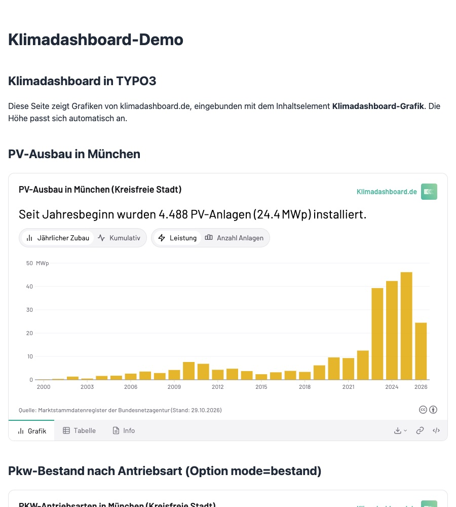
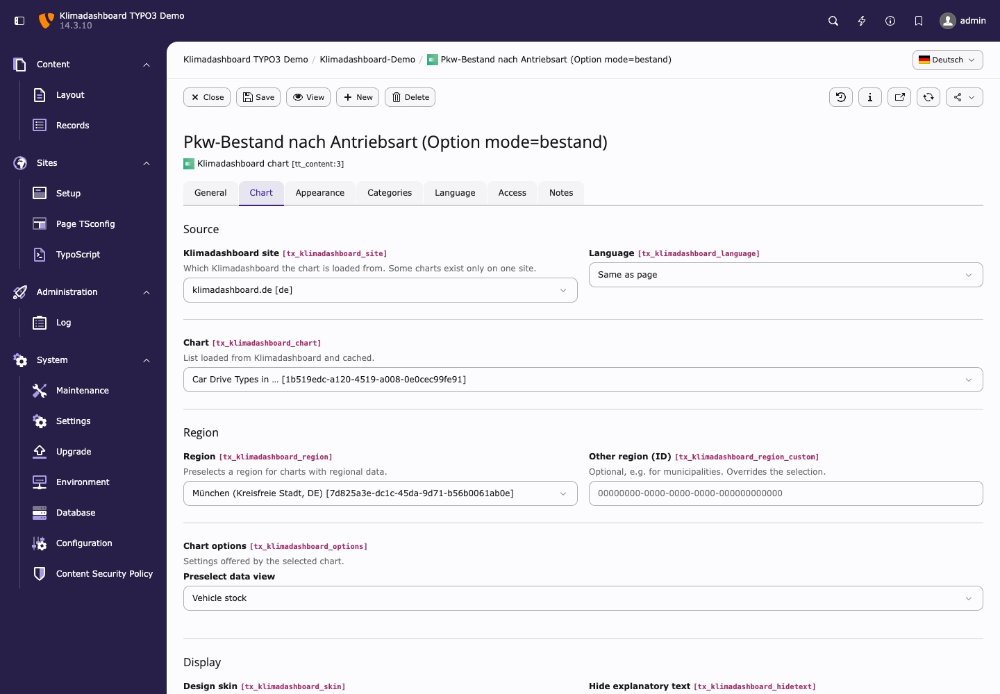
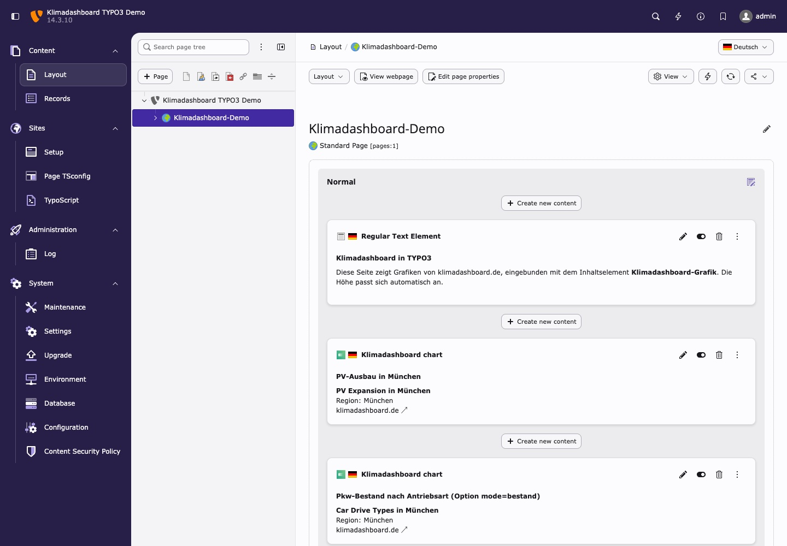
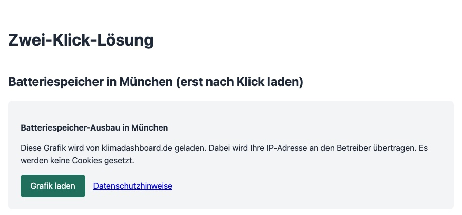

# Klimadashboard for TYPO3

TYPO3 extension (key `klimadashboard`, package `klimadashboard/typo3-klimadashboard`) that embeds
charts from [Klimadashboard](https://klimadashboard.org) (klimadashboard.de, .at, .org) as content elements.

- **Chart picker:** all published Klimadashboard charts, loaded from the public, read-only
  Klimadashboard API and cached (default 4 h, last good response kept if the API is down).
- **Settings per element:** Klimadashboard site (de/at/org), language (de/en or same as the page),
  region (regional associations, states, districts and independent cities, or any region ID),
  chart-specific options (e.g. *vehicle stock* vs. *new registrations*), design skin, hiding the explanatory text,
  automatic or fixed height, click-to-load.
- **Editors need no HTML rights.** The page module shows a preview with chart, region and skin.
- **Auto-height:** the chart's iframe reports its height through `postMessage`, and a small script in the
  extension resizes it (sender origin and frame are checked). No external scripts are loaded.
- **Accessibility (WCAG 2.1 AA):** the iframe gets the chart title as an accessible name and a `lang`
  attribute. The charts provide their own text alternatives and table views. The click-to-load button is
  keyboard-operable and moves focus to the chart after loading.
- **Privacy (DSGVO):** no cookies and no tracking. The chart is loaded from klimadashboard.* (EU hosting),
  which transmits the visitor's IP address to Klimadashboard. A two-click mode (optional, global or per
  element) loads the chart only after consent.
- **Content Security Policy:** on TYPO3 v12+ the extension adds `frame-src` for the Klimadashboard
  domains automatically (`Configuration/ContentSecurityPolicies.php`). On v11, add
  `frame-src https://klimadashboard.de https://klimadashboard.at https://klimadashboard.org` to your policy.

Compatible with **TYPO3 11.5 LTS, 12.4 LTS, 13.4 LTS and 14.3 LTS**, PHP 7.4–8.4.

| Frontend (auto-height) | Editing form (Chart tab) |
|---|---|
|  |  |
| **Page module preview** | **Click-to-load** |
|  |  |

**Test status:** tested end to end on **TYPO3 11.5.41 (PHP 8.1), 12.4.45 (PHP 8.2), 13.4.37 (PHP 8.3) and
14.3.10 (PHP 8.4)** with the DDEV setup below: frontend, auto-height, click-to-load, editing form, saving,
page module preview, new content element wizard; on 12.4 and 13.4 also with the frontend Content Security
Policy enforced. The code passes PHP 7.4 lint.

The full manual is in [`Documentation/`](Documentation/Index.rst) (rendered on docs.typo3.org after the
first TER release); changes are listed in [CHANGELOG.md](CHANGELOG.md).

### Known limitations (depend on klimadashboard-core)

- `/api/skins` and the skin feature are not on production yet. Until they are deployed, the skin select
  shows the configured list and the `skin` parameter has no visible effect.
- If `/api/embed-options` is unreachable, options already stored on an element are listed and kept when it is saved.
- `lang=en`: the embed route currently uses `lang` only for its server-rendered snapshot, so the interactive chart stays German.

## Installation

```bash
composer require klimadashboard/typo3-klimadashboard
```

Then include the TypoScript:

- **TYPO3 v13/v14:** add the site set *Klimadashboard* (`klimadashboard/klimadashboard`) to your site
  (Site Management > Sites > Sets), or as a dependency of your own site package set.
- **TYPO3 v11/v12:** include the static template *Klimadashboard* in your TypoScript record.

The extension requires `fluid_styled_content`: the element uses `lib.contentElement`, so header,
frames and layouts follow your site.

## Configuration

*Admin Tools > Settings > Extension Configuration > klimadashboard*

| Setting | Default | |
|---|---|---|
| `baseUrlDe` / `baseUrlAt` / `baseUrlOrg` | `https://klimadashboard.{de,at,org}` | Embed hosts, e.g. for a staging instance |
| `defaultSite` | `de` | Site used when an element has none set |
| `directusUrl` | `https://base.klimadashboard.org` | Public Klimadashboard data API (charts, regions) |
| `cacheLifetime` | `14400` | Cache lifetime of API responses (s) |
| `excludeChartTypes` | `test*` | Chart types hidden from the picker |
| `regionLayers` / `regionCountries` | `group,state,district` / `DE,AT` | Regions offered in the region select |
| `skins` | (empty) | Additional skins (`id:Label`, comma separated, e.g. `my-skin:My organisation`) |
| `fetchSkins` | on | Also load the skin list from `GET <defaultSite>/api/skins` |
| `consent` | off | Two-click mode for all elements (elements can override) |
| `privacyUrl` | Klimadashboard privacy policy | Linked in the click-to-load notice |

Per site, use Page TSconfig, e.g. to preselect a skin and remove options:

```
TCAdefaults.tt_content.tx_klimadashboard_skin = my-skin
TCEFORM.tt_content.tx_klimadashboard_site.removeItems = at,org
```

The colours of the click-to-load notice are CSS custom properties (`--klimadashboard-consent-bg`,
`--klimadashboard-button-bg`, …) in `Resources/Public/Css/embed.css` and can be overridden in the site CSS.

## How it works

Each element renders an iframe pointing at the existing Klimadashboard embed route:

```
https://klimadashboard.de/embed/<chartId>?auto=true&region=<regionId>&lang=de&skin=<skinId>&<chart options>
```

The extension uses these Klimadashboard endpoints (all public, read-only, no credentials):

| Endpoint | Used for |
|---|---|
| `base.klimadashboard.org/items/charts` | Chart picker and iframe titles |
| `base.klimadashboard.org/items/regions` | Region select |
| `klimadashboard.*/api/skins` | Skin select (see `docs/embed-skins.md` in klimadashboard-core) |
| `klimadashboard.*/api/embed-options/<chartId>` | Chart-specific options (see `docs/embed-options.md` in klimadashboard-core) |

If an endpoint is missing or unreachable, the extension falls back to the cached response or the
configured list. Existing elements keep their stored values.

## Local test environment (DDEV)

Requirements: [DDEV](https://ddev.com) with a Docker provider (e.g. Colima, OrbStack or Docker Desktop).
The DDEV project lives in the repository root. There is one TYPO3 composer project per supported version:
`dev/v14` (TYPO3 14.3, PHP 8.4), `dev/v13` (13.4, PHP 8.3), `dev/v12` (12.4, PHP 8.2) and `dev/v11` (11.5,
PHP 8.1). All
install this extension from `../../` as a symlinked path repository, together with a minimal site package
(`dev/packages/demo_site`).

```bash
dev/setup.sh            # TYPO3 14.3: install, admin user, demo pages (re-run to reset)
dev/setup.sh 13         # switch to TYPO3 13.4 (also 12 or 11; resets the database)
ddev start              # later: start the version set up last
ddev stop               # stop the containers
ddev delete -O          # remove containers and database
```

`setup.sh` switches versions by writing `.ddev/config.local.yaml` (composer root, docroot, PHP version).
TYPO3 v11 is installed with `helhum/typo3-console`. v11 and v12 include the TypoScript through a template
record; v13 and v14 use site sets.

> **v11 and v12 are for local testing only.** Their last public releases have security advisories that are
> fixed only in paid ELTS releases, so their `composer.json` disables Composer's advisory block. Never deploy them.

To test the Content Security Policy, enable it in the (git-ignored) `dev/vXX/config/system/additional.php`:
`$GLOBALS['TYPO3_CONF_VARS']['SYS']['features']['security.frontend.enforceContentSecurityPolicy'] = true;`

The project uses the TLD `.localhost` (resolves to 127.0.0.1 without /etc/hosts or DNS changes);
`ddev describe` shows the exact port (here: 30000).

- Frontend: http://klimadashboard-typo3.localhost:30000/ (demo page), `/zwei-klick` (click-to-load), `/en/` (English)
- Backend: http://klimadashboard-typo3.localhost:30000/typo3/
- **Admin login:** `setup.sh` generates local-only test credentials and stores them in `dev/.env.local`
  (git-ignored). Read them with `cat dev/.env.local`.

The demo content is in `dev/demo/`. Clear the API cache with `ddev exec --dir /var/www/html/dev/v14 vendor/bin/typo3 cache:flush`
(other versions: `dev/v13`, `dev/v12`; v11 uses `vendor/bin/typo3cms cache:flush`).

## Releasing

Releases are published from version tags (`1.0.0`, no `v` prefix):

1. Update `version` in `ext_emconf.php`, `release` in `Documentation/guides.xml` and `CHANGELOG.md`.
2. Commit, then create an annotated tag. Its message becomes the TER upload comment:
   `git tag -a 1.0.1 -m "Fix …"` and `git push origin main 1.0.1`.
3. `.github/workflows/publish.yml` checks that the tag matches `ext_emconf.php` and publishes to the TER
   with [tailor](https://github.com/TYPO3/tailor). Packagist updates through its GitHub webhook.
   docs.typo3.org renders `Documentation/` through its webhook.

One-time setup:

- **GitHub:** create `klimadashboard/typo3-klimadashboard` (public) and push.
- **Packagist:** submit the repository URL on packagist.org and enable the GitHub hook.
- **TER:** register the extension key `klimadashboard` on extensions.typo3.org (*My Extensions*), create an
  access token for it and store it as the repository secret `TYPO3_API_TOKEN`.
- **docs.typo3.org:** add the webhook `https://docs-hook.typo3.org` (content type `application/json`, push
  events) to the GitHub repository, see the TYPO3 documentation on publishing extension manuals.

`.gitattributes` keeps `dev/`, `.ddev/` and `.github/` out of the release archives. CI (`.github/workflows/ci.yml`)
lints PHP 7.4–8.4, validates `composer.json` and the XLIFF files and renders the documentation.

## License

GPL-2.0-or-later
